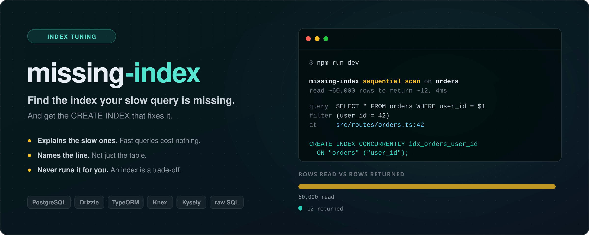

<div align="center">



# missing-index

[](https://www.npmjs.com/package/missing-index)
[](./LICENSE)
[](https://nodejs.org)
[](./package.json)

Companion to [nplusone](https://github.com/Truta446/nplusone).<br/>
One finds the query you run too many times. This one finds the query with no index.

</div>

---

```
missing-index sequential scan on orders — read ~60,000 rows to return ~12, 4ms
  query  SELECT * FROM orders WHERE user_id = $1
  filter (user_id = 42)
  at     src/routes/orders.ts:42:14

  CREATE INDEX CONCURRENTLY idx_orders_user_id ON "orders" ("user_id");
```

That is real output, not a mockup — 60,000 rows read to return 12.

## Install

```sh
npm install --save-dev missing-index
```

Tested on Node **18, 20, 22 and 24**.

The package is ESM. `import` works on every version above; `require()` works
from Node 20.19 onwards, which is where Node backported requiring an ES module.
On Node 18 — end-of-life since April 2025 — use `import`.

## Use

```ts
import pg from "pg";
import { configure } from "missing-index";
import { instrumentPg } from "missing-index/pg";

configure({ thresholdMs: 50 });
instrumentPg(pg);
```

That is the whole setup. Run your app, use it normally, and anything worth indexing prints itself.

## Compatibility

Because it hooks the **driver**, every query builder and ORM on top of that driver is covered without needing its own adapter.

| Your stack | Setup | |
| --- | --- | :--: |
| **PostgreSQL** (`pg`) | `instrumentPg(pg)` | ✅ |
| **MySQL / MariaDB** (`mysql2`) | `instrumentMysql2(mysql)` | ✅ |
| **Drizzle** | driver **+** `instrumentDrizzle(db)` | ✅ |
| **Knex** | via its driver | ✅ |
| **TypeORM** | via its driver | ✅ |
| **Sequelize** | via its driver | ✅ |
| **Kysely** | via its driver | ✅ |
| raw SQL | via its driver | ✅ |

> **Drizzle needs the extra adapter for one reason:** a Drizzle query is a lazy
> thenable, so what triggers execution is the runtime calling `.then()`, not
> your code. By then the caller's frame has left the stack and the suggestion
> would be reported against nothing. `instrumentDrizzle(db)` captures the call
> site while the query is still being built. Use both together — the driver
> reports the SQL, Drizzle reports the line.

```ts
import mysql from "mysql2";
import { instrumentMysql2 } from "missing-index/mysql2";

instrumentMysql2(mysql);   // also covers mysql2/promise
```

MySQL has no `CREATE INDEX CONCURRENTLY`, so its suggestions carry
`ALGORITHM=INPLACE, LOCK=NONE` — the equivalent promise that the table stays
writable while the index builds.

## Guarding it in CI

A detector you have to remember to read decays. An assertion does not.

```ts
import { expectNoMissingIndex } from "missing-index/test";

test("orders page uses its indexes", async () => {
  await expectNoMissingIndex(() => loadOrdersPage(userId));
});
```

It throws a plain `Error`, so Jest, Vitest and `node:test` all report it with no
plugin. The helper sets `thresholdMs: 0` for you: in a test you want the
assertion to be about the **plan**, not about how fast the CI runner happened to
be that morning.

## What it actually does

When a query takes longer than `thresholdMs`, the library runs `EXPLAIN` on it and looks for one specific thing: **a sequential scan carrying a filter**. That means PostgreSQL read the whole table and threw most of it away.

It then asks the planner how big that table really is, and only speaks up when the scan was expensive.

Three decisions are worth knowing about, because they are what keeps it usable:

**It measures the table, not the result.** A node's `Plan Rows` is how many rows survive the filter — reading 60,000 rows to return 12 shows up as "12". Judging by that number would discard exactly the queries worth reporting, so the size comes from `pg_class.reltuples` instead, which is the planner's own estimate and costs one indexed lookup.

**`ANALYZE` is off.** With it, PostgreSQL *executes* the statement to measure it — which for an `UPDATE` means running it twice. The estimated plan is enough to see a sequential scan, and it cannot corrupt anything. Only `SELECT`s are explained at all, and a `SELECT` hiding a write in a CTE is skipped.

**Equality columns come before the range column.** `WHERE status = $1 AND created_at > $2` suggests `(status, created_at)`, never the reverse — a range column placed first makes the rest of a composite index unusable for the equality lookup. That is the most common mistake in a hand-written composite index.

## Configuration

```ts
configure({
  thresholdMs: 50,              // only explain queries slower than this
  minRows: 1000,                // ignore tables smaller than this
  ignoreTables: [/^audit_/],    // never suggest indexes for these
  ignore: [/pg_catalog/],       // never explain queries matching these
  captureStack: true,           // attribute each finding to a line of code
  onFinding: (f) => metrics.increment("missing_index", { table: f.suggestion.table }),
  reporter: (f) => logger.warn(f),
  enabled: process.env.NODE_ENV !== "production",   // the default
});
```

Each suggestion is printed **once per process**, so a query in a loop does not repeat the same `CREATE INDEX` fifty times.

## Cost

Explaining a query costs one extra round trip, which is why `thresholdMs` exists — fast queries are never explained, whatever their plan looks like. The detector is disabled when `NODE_ENV === "production"` unless you turn it on deliberately.

`EXPLAIN` runs on the **same connection** as the original query, so it sees the same `search_path`, temporary tables and transaction state. A different connection would explain a different query.

## Limitations

Worth knowing before filing an issue:

- **It suggests, it does not decide.** An index costs write throughput and disk. On a write-heavy table the suggestion may be the wrong trade — the tool has no way to know that, and says so by printing SQL rather than running it.
- **The suggestion is never run for you**, on purpose. It comes with `CONCURRENTLY` so it is safe on a live table; a plain `CREATE INDEX` locks writes for its whole duration.
- **Partial and expression indexes are out of scope.** A filter like `WHERE lower(email) = $1` needs `ON (lower(email))`, and the suggestion will name the column rather than the expression.
- **Tables never `ANALYZE`d have no statistics**, so nothing is reported for them.

## Tests

```sh
npm test                    # 48 tests, no database needed
MISSING_INDEX_PG=1 npm test # plus integration against a real PostgreSQL
```

The integration tests need a throwaway server:

```sh
docker run -d --name mi-pg --tmpfs /var/lib/postgresql/data:rw,size=512m \
  -e POSTGRES_PASSWORD=test -e POSTGRES_DB=testdb \
  -e PGDATA=/var/lib/postgresql/data/pg -p 55440:5432 postgres:16-alpine
```

## License

MIT
